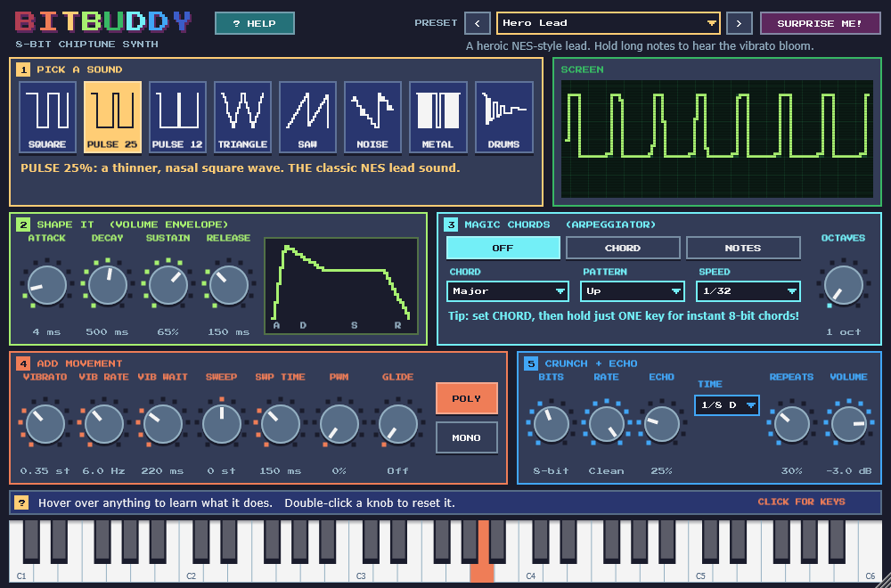

# BitBuddy – an easy, fun chiptune synth (VST3 + Standalone)

BitBuddy recreates the sound chips of classic game consoles (NES, Game Boy,
C64) and builds their famous tricks into simple knobs, so making 8-bit music
is quick and fun even if you've never made music before.



**New to all this?** Start with the **[Beginner's Guide](docs/BEGINNERS-GUIDE.md)**.

## Features

- **8 chip sounds:** Square, Pulse 25%, Pulse 12.5%, 4-bit Triangle, Saw, LFSR Noise,
  "Metal" short-mode noise (tuned to your keys), and a 12-piece synthesized **Drum Kit**
- **Magic Chords:** hold one key to get the classic fast-arpeggio chiptune chord
  (9 chord types, 5 patterns, tempo-synced or 15/30/60 Hz "frame rate" speeds),
  plus a held-notes arpeggiator
- **Movement:** delayed vibrato, pitch sweeps (lasers, jumps, kicks), PWM, glide, mono/poly
- **Crunch + Echo:** bit depth, sample-rate reduction, tempo-synced ping-pong echo
- **21 presets**, including leads, bass, chords, drums and sound effects (Coin, Jump, Laser, Power Up, Explosion)
- **SURPRISE ME!** button for random-but-musical sounds
- **Built-in help:** hover any control for a plain-English explanation; a numbered 1–5 layout walks you through making a sound
- Live waveform "screen", on-screen keyboard, and computer-keyboard playing that stays active while you
  tweak knobs (a **KEYS ON** indicator shows when your letter keys are playing)
- Mod wheel → vibrato, pitch bend (±2 semitones), sustain pedal
- Resizable window; very light on CPU (~1% of one core for 8-voice chords)

## Install (Windows)

1. Build it (below), or use the files in `build\BitBuddy_artefacts\Release\`.
2. Right-click **`install-plugin.ps1`** → *Run with PowerShell* → click **Yes**.
   It copies `BitBuddy.vst3` into `C:\Program Files\Common Files\VST3`, where every DAW looks.
3. In your DAW, re-scan plugins and add **BitBuddy** as an instrument.

Or just run the standalone app: `build\BitBuddy_artefacts\Release\Standalone\BitBuddy.exe`.

**Works in:** REAPER, Cakewalk, FL Studio, Ableton Live, Bitwig, Studio One, Cubase and
any other DAW that supports VST3 instruments. *(Logic/GarageBand need an AU build on a Mac.)*

## Share it with a friend

```powershell
powershell -ExecutionPolicy Bypass -File tools\make-share-package.ps1
```

This creates `dist\BitBuddy-<version>-Windows.zip`, a self-contained package with the standalone app,
the VST3, a double-click installer (`Install BitBuddy.bat`), a plain-text *READ ME FIRST*,
the beginner's guide, the demo song, licenses and the source code. Your friend needs Windows 10/11 (64-bit).

## Demo

`demo/BitBuddy-Demo-PixelQuest.wav` is an original 140 BPM tune made only with BitBuddy presets.
`demo/midi/` has every part as a MIDI file, so you can load it in your DAW and remix it.

## Build from source

Requirements: Windows 10/11, [Visual Studio 2022 Build Tools](https://visualstudio.microsoft.com/downloads/)
(C++ workload), [CMake](https://cmake.org/) 3.22+, git.

```powershell
git clone --recurse-submodules <this repo>
cd BitBuddy
cmake -B build -G "Visual Studio 17 2022" -A x64
cmake --build build --config Release --parallel
```

The first build takes ~5 minutes (it compiles JUCE). Later builds take ~20 seconds.

Outputs:

| File | What |
|---|---|
| `build/BitBuddy_artefacts/Release/VST3/BitBuddy.vst3` | the plugin |
| `build/BitBuddy_artefacts/Release/Standalone/BitBuddy.exe` | standalone app |
| `build/BitBuddyTestHost_artefacts/Release/BitBuddyTestHost.exe` | test / demo / screenshot tool |

## Testing

```powershell
# 44 automated tests: loads the real VST3 like a DAW and measures the audio
.\build\BitBuddyTestHost_artefacts\Release\BitBuddyTestHost.exe --test build\BitBuddy_artefacts\Release\VST3\BitBuddy.vst3

# 9 UI tests: opens a real window, simulates mouse clicks, checks the computer keyboard stays on the piano
.\build\BitBuddyTestHost_artefacts\Release\BitBuddyTestHost.exe --focus-test

# Re-render the demo song + MIDI files, and the UI screenshots
.\build\BitBuddyTestHost_artefacts\Release\BitBuddyTestHost.exe --demo build\BitBuddy_artefacts\Release\VST3\BitBuddy.vst3 demo
.\build\BitBuddyTestHost_artefacts\Release\BitBuddyTestHost.exe --snapshot docs\screenshots
```

Also validated with [pluginval](https://github.com/Tracktion/pluginval) at strictness level 10 (all tests pass).
See [docs/test-results.txt](docs/test-results.txt) and [docs/pluginval](docs/pluginval).

## Project layout

```
src/ChipEngine.*        the sound chip: oscillators, LFSR noise, arpeggiators, drums
src/Effects.h           crunch (bit/rate reduction), ping-pong echo, DC blocker
src/Parameters.*        every knob the DAW can see and automate
src/Presets.*           the 21 factory presets
src/PluginProcessor.*   glue between the DAW, MIDI and the engine; save/load
src/PluginEditor.*      the UI (sections 1-5, scope, keyboard, help)
src/RetroLookAndFeel.*  pixel font, palette, LED knobs
tools/TestHost.cpp      automated tests, demo song renderer, UI snapshots
docs/                   beginner's guide, workflow notes, test results, screenshots
external/JUCE           JUCE 8.0.15 (git submodule)
```

## Licensing notes

- Built with [JUCE](https://juce.com) 8, which is dual-licensed under **AGPLv3** or a commercial
  JUCE license (free "Starter" tier for small personal projects). If you share or sell BitBuddy
  publicly, release its source under AGPLv3 or get a JUCE license.
- Pixel font: **Press Start 2P** by CodeMan38, SIL Open Font License 1.1 (see `assets/PressStart2P-OFL.txt`).
- VST is a trademark of Steinberg Media Technologies GmbH.
