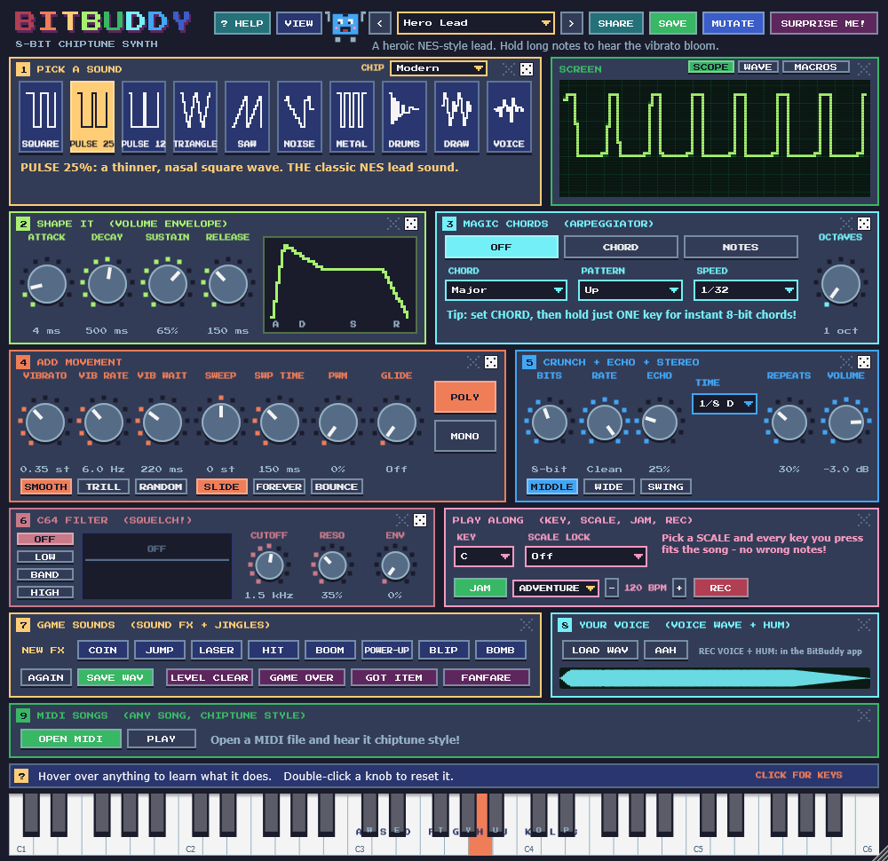

# BitBuddy – an easy, fun chiptune synth (Windows, Mac, Android)

[](https://github.com/metavillain/BitBuddy/actions/workflows/build.yml)

BitBuddy recreates the sound chips of classic game consoles (NES, Game Boy,
C64) and builds their famous tricks into simple knobs, so making 8-bit music
is quick and fun even if you've never made music before.



## ⬇️ Download

**[Get the latest version](https://github.com/metavillain/BitBuddy/releases/latest)**: pick the
**Windows** or **macOS** zip, unzip it, and open *READ ME FIRST.txt*. No other software needed.

| Platform | What you get | Status |
|---|---|---|
| **Windows** 10 / 11 | app + VST3 plugin | ✅ download |
| **Mac** (Apple Silicon + Intel, macOS 10.13+) | app + Audio Unit + VST3 | ✅ download |
| **Android** 7.0+ phone / tablet | app (`.apk`); on phones the keyboard stays pinned and the rest scrolls; shake + tilt tricks | ✅ download |
| **iPhone / iPad** | app + AUv3 (GarageBand, AUM…) | 🧪 builds and runs in the iPad simulator; sharing it needs a paid Apple Developer account |

**New to all this?** Start with the **[Beginner's Guide](docs/BEGINNERS-GUIDE.md)**.

## Features

- **10 chip sounds:** Square, Pulse 25%, Pulse 12.5%, 4-bit Triangle, Saw, LFSR Noise,
  "Metal" short-mode noise (tuned to your keys), a 12-piece synthesized **Drum Kit**, **DRAW**
  (draw your own 32-step, 4-bit wave like the Game Boy's wave channel) and **VOICE**: your own
  recording played like the NES sample channel (1-bit "DPCM" on NES, 4-bit on Game Boy / C64)
- **Chip modes:** Modern, or real **NES / Game Boy / C64** behaviour (note limits, 4-bit volume steps,
  the chips' own pitch tables, on/off NES triangle, 16-speed NES noise, output tone)
- **Magic Chords:** hold one key to get the classic fast-arpeggio chiptune chord
  (9 chord types + **SMART** chords that follow your key, 5 patterns, tempo-synced or 15/30/60 Hz),
  plus a held-notes arpeggiator
- **Scale Lock:** pick a key + scale (8 scales) and every note you play fits; the piano shows the scale
- **Instrument macros** (FamiTracker style): VOL / ARP / PITCH / DUTY step sequences at 60 steps/s with loops
- **C64 filter:** resonant low / band / high pass with a per-note envelope
- **Movement:** delayed vibrato (**smooth, trill or random**), pitch sweeps (**slide, forever** like the
  NES sweep unit, or **bounce** for sirens), PWM, glide, mono/poly
- **Crunch + Echo + Stereo:** bit depth, sample-rate reduction, tempo-synced ping-pong echo,
  **Game Boy-style stereo** (each note on its own side) or a bar-synced **swing** from side to side
- **Game sounds:** one tap makes a new **COIN, JUMP, LASER, HIT, BOOM, POWER-UP, BLIP** or **BOMB**;
  **SAVE WAV** for your own game; **jingles** (level clear, game over, got item, fanfare) written in your key
- **Sound codes:** **SHARE** turns a sound into a line of text (`BB1-...`) a friend can paste into their BitBuddy
- **31 presets**, including leads, bass, chords, drums, sound effects, and demos of the 1.1 + 1.2 features
- **My Presets** (save your own), **SURPRISE ME!**, per-section **dice** and **MUTATE**
- **In the app:** **JAM** (a drums + bass + chords band in your key, 4 styles), **REC** (WAV + MIDI),
  **REC VOICE** (record your voice for the VOICE wave), **HUM** (sing a tune, BitBuddy plays it) and
  **MIDI SONGS** (open any `.mid`: melody on your sound, triangle bass, pulse chords, drum kit)
- **Phone tricks:** slide a finger up / down on a key to bend it (everywhere), **shake** the phone for a
  new sound, **tilt** it for wobble
- **Your layout:** hide boxes, drag them around, hide the dice (**VIEW** menu), 4 colour themes, and BIT the dancing mascot
- **Built-in help:** hover any control for a plain-English explanation; a numbered 1–5 layout walks you through making a sound
- Live waveform "screen", on-screen keyboard, and computer-keyboard playing that stays active while you
  tweak knobs (a **KEYS ON** indicator shows when your letter keys are playing)
- Mod wheel → vibrato, pitch bend (±2 semitones), sustain pedal
- Resizable window; very light on CPU (under 1% of one core for 8-voice chords, ~0.03% when idle)

## Install

**From a download (easiest):** see *READ ME FIRST.txt* in the zip.

- **Windows:** `BitBuddy.exe` plays on its own; `Install BitBuddy.bat` puts the VST3 plugin where every DAW looks.
- **Mac:** `Install BitBuddy.command` installs the app plus the **Audio Unit** (GarageBand, Logic) and **VST3**
  plugins. macOS will warn that the developer can't be verified: allow it under
  *System Settings → Privacy & Security → Open Anyway*.

**From your own Windows build:** right-click **`scripts\install-plugin.ps1`** → *Run with PowerShell* → **Yes**.

**Works in:** GarageBand, Logic Pro, REAPER, Cakewalk, FL Studio, Ableton Live, Bitwig, Studio One, Cubase
and any other DAW that supports VST3 or Audio Unit instruments.

## Releases (how the downloads are made)

Every push to `main` builds and tests Windows, macOS, Android (APK + emulator launch test) and iOS
(iPad simulator launch test) on GitHub Actions ([workflow](.github/workflows/build.yml)).
Pushing a version tag publishes a Release page with the Windows and Mac zips and the Android APK:

```powershell
git tag v1.0.2
git push origin v1.0.2
```

The zips are made by `scripts/make-share-package.ps1` (Windows) and `scripts/make-share-package-mac.sh` (Mac):
app + plugins + a double-click installer + *READ ME FIRST* + beginner's guide + demo + licenses + source.

## Demo

`demo/BitBuddy-Demo-PixelQuest.wav` is an original 140 BPM tune made only with BitBuddy presets.
`demo/midi/` has every part as a MIDI file, so you can load it in your DAW and remix it.

## Build and test

Requirements: Windows 10/11, [Visual Studio 2022 Build Tools](https://visualstudio.microsoft.com/downloads/)
(C++ workload), [CMake](https://cmake.org/) 3.22+, git.

```powershell
git clone --recurse-submodules <this repo>
cd BitBuddy
powershell -ExecutionPolicy Bypass -File scripts\build-and-test.ps1
```

That one script builds everything (Release) and runs every check, writing reports to
[`docs/reports/`](docs/reports):

| Check | What it proves |
|---|---|
| Audio tests (`test-results.txt`) | 105 tests that load the real VST3 like a DAW: tuning, arpeggiators, drums, presets, save/restore, echo tails, limiter, Scale Lock, Smart chords, filter, chip modes, macros, drawn waves, Jam band, recording, My Presets, sweep modes, vibrato shapes, stereo, sound effects, SAVE WAV, jingles, sound codes, VOICE wave, HUM pitch tracking, MIDI songs, slide-to-bend, CPU |
| Focus + layout test (`focus-test.txt`) | opens a real window, simulates clicks and a slide on a key, checks your computer keys keep playing; hides, moves and resets boxes; hides the dice; phone layout |
| Benchmark (`benchmark.txt`) | CPU cost of chords, a lead, drums and idle |
| [pluginval](https://github.com/Tracktion/pluginval) (`pluginval.txt`) | industry plugin validator at strictness level 10 |

The first build takes ~5 minutes (it compiles JUCE). Outputs:

| File | What |
|---|---|
| `build/BitBuddy_artefacts/Release/VST3/BitBuddy.vst3` | the plugin |
| `build/BitBuddy_artefacts/Release/Standalone/BitBuddy.exe` | standalone app |
| `build/BitBuddyTestHost_artefacts/Release/BitBuddyTestHost.exe` | test host (`--test`, `--focus-test`, `--bench`, `--demo`, `--snapshot`) |

Re-render the demo song and MIDI parts:
`BitBuddyTestHost.exe --demo build\BitBuddy_artefacts\Release\VST3\BitBuddy.vst3 demo`

## Project layout

```
src/            the plugin
  ChipEngine.*        the sound chip: oscillators, LFSR noise, arpeggiators, drums, macros, chip modes
  Scales.h            scales, Scale Lock snapping, Smart-chord triads
  Effects.h           C64 filter, console tone, crunch, ping-pong echo, DC blocker
  JamBand.*           the JAM backing band (3 more chip engines + a step sequencer)
  Recorder.*          REC: WAV + MIDI recording on a background thread
  NotePlayer.*        plays note lists sample-accurately (sound effects, jingles, MIDI songs)
  GameSounds.*        the sound effect recipes and the jingle writer
  SoundCode.cpp       SHARE: a sound as a line of text (and back)
  VoiceSample.*       the VOICE wave's recording (trim, resample, built-in "aah")
  MicInput.*          the app's microphone (REC VOICE, HUM)
  HumTracker.*        HUM: YIN pitch tracking -> notes
  SongPlayer.*        MIDI SONGS: who plays what + the song band
  Motion*             phone tricks: the motion sensor (Android Java listener, iOS CoreMotion)
  Parameters.*        every knob the DAW can see and automate
  Presets.*           the 31 factory presets
  PluginProcessor.*   glue between the DAW, MIDI and the engine; save/load; My Presets
  PluginEditor.*      the UI (boxes, screen editors, keyboard, help, BIT, layout)
  RetroLookAndFeel.*  pixel font, colour themes, LED knobs, settings file
tests/TestHost.cpp  automated tests, benchmark, demo renderer, UI snapshots
scripts/            build-and-test, install-plugin, make-share-package
assets/             pixel font + its license
demo/               demo song (WAV) + MIDI parts
docs/               beginner's guide, workflow notes, test reports, screenshot
external/JUCE       JUCE 8.0.15 (git submodule)
```

## License

- **BitBuddy is free software under the [GNU AGPLv3](LICENSE).** You can use, study, share and change it;
  if you distribute a modified version, share its source under the same license.
- Built with [JUCE](https://juce.com) 8, used under its AGPLv3 option.
- Pixel font: **Press Start 2P** by CodeMan38, SIL Open Font License 1.1 (see `assets/PressStart2P-OFL.txt`).
- VST is a trademark of Steinberg Media Technologies GmbH. Audio Units, Logic Pro and GarageBand are trademarks of Apple Inc.
